<p align="center">
    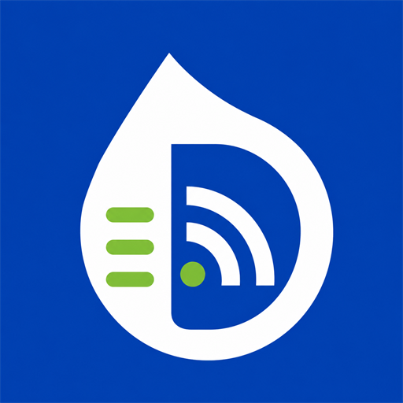
</p>

<h1 align="center"><b>Droidrops</b></h1>

<p align="center">
    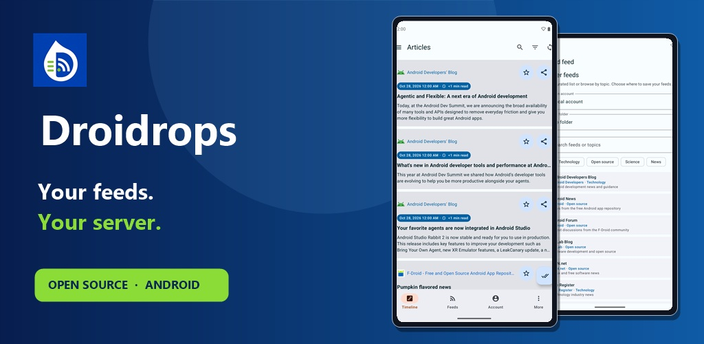
</p>

<h2 align="center">Watch the Droidrops promo</h2>

<p align="center">
    <a href="docs/assets/droidrops-promo-en-motion.mp4">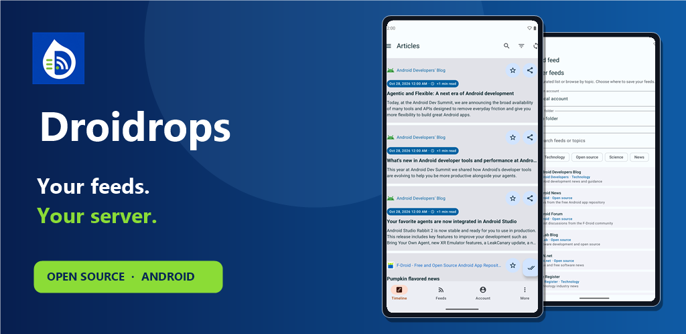</a>
</p>

<p align="center">
    <a href="docs/assets/droidrops-promo-en-motion.mp4">Watch the landscape video</a>
    · <a href="https://youtu.be/E_obOWTfAaU">Landscape on YouTube</a>
    · <a href="docs/assets/droidrops-promo-en-vertical.mp4">Watch the vertical video</a>
    · <a href="https://youtube.com/shorts/uZRU5_neZVg">Vertical on YouTube</a>
</p>

<p align="center">
<a href="https://github.com/thekester/Droidrops/actions"></a>

<h4 align="center">Droidrops is a fork of Readrops, a multi-services RSS client for Android. Its name is composed of "Read" and "drops", where drops are articles in an ocean of news.</h4>

<p align="center">
    <a href="https://github.com/thekester/Droidrops/releases/latest">Latest release</a>
    · <a href="https://f-droid.org/fr/packages/com.droidrops.app/"></a>
    · Google Play release expected in about two weeks
</p>

# Features

- Local RSS parsing (RSS1, RSS2, ATOM, JSONFeed)
- External services:
  - FreshRSS
  - Nextcloud News
  - Native Miniflux REST API (Miniflux v2.0.49+ for incremental sync)
  - Fever API
  - Google Reader API
- Multi-account
- Feeds and folders management (create, update and delete feeds/folders if supported by the service API)
- OPML import/export
- Background synchronisation
- Notifications

# Screenshots

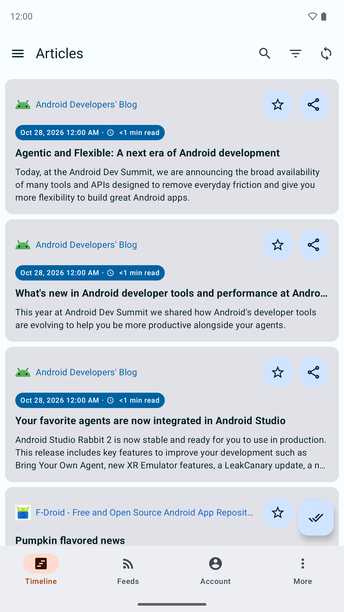 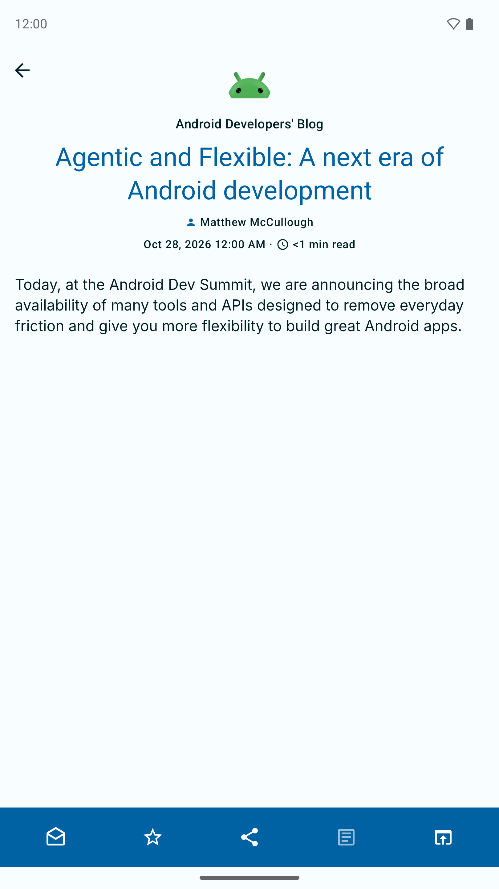 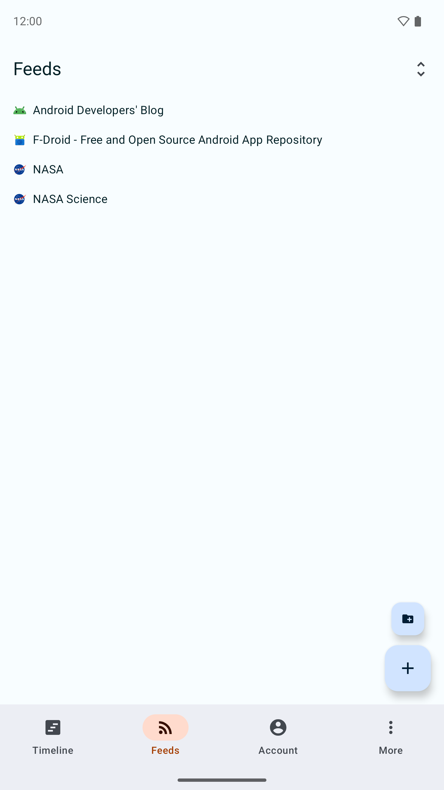

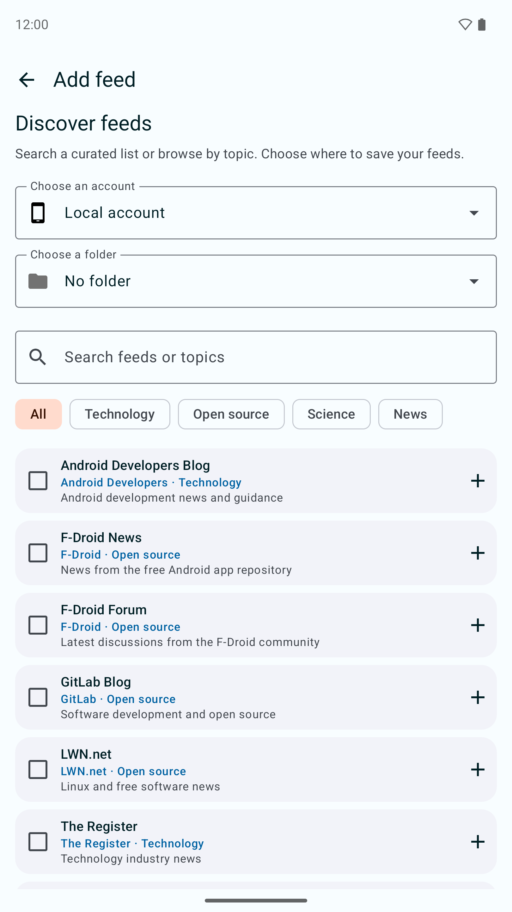 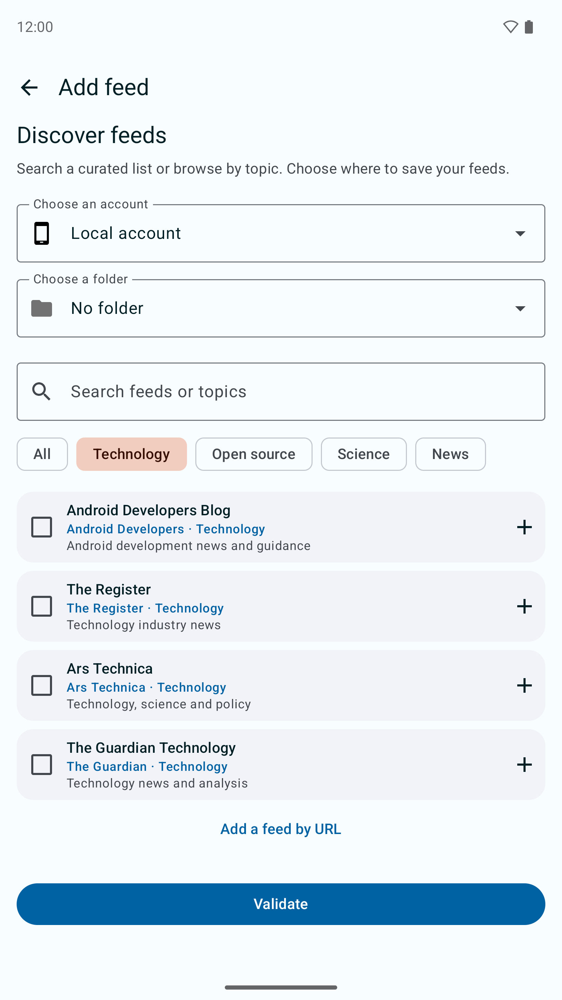 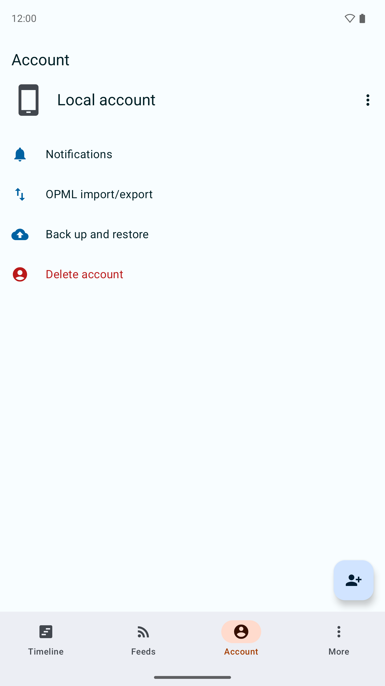

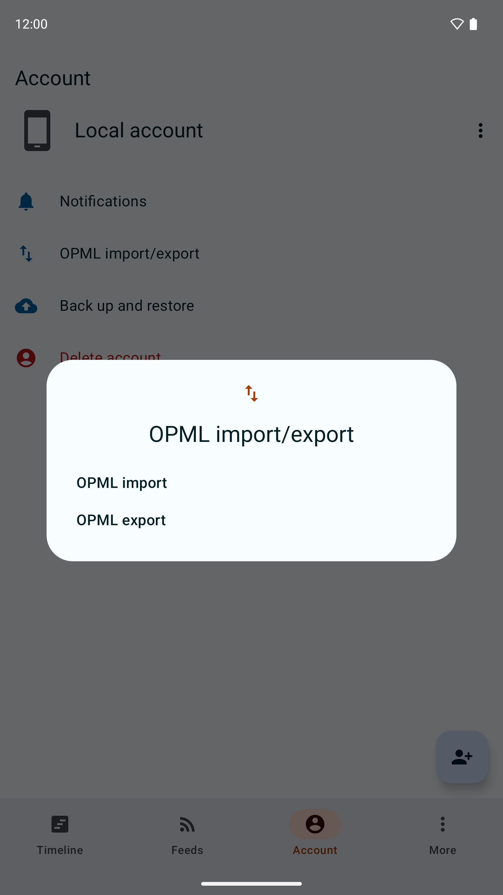 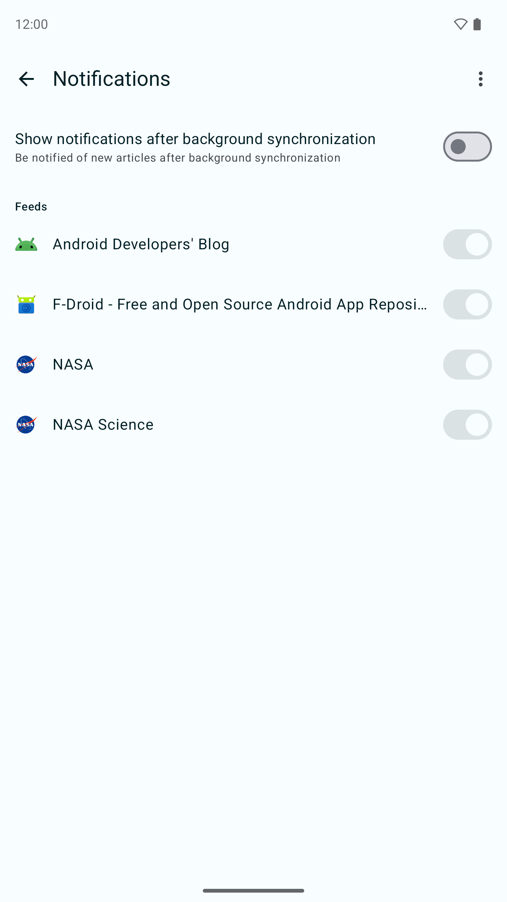

# Licence

This project is released under the GPLv3 licence.

# Develop

During development, you can autofill the app's login form by filling the project's `local.properties` like so:

```properties
debug.<account_type>.login=<login>
debug.<account_type>.password=<password>
debug.<account_type>.url=https\://<your_instance>

# For instance:
debug.nextcloud_news.login=Test user
debug.nextcloud_news.password=1234
debug.nextcloud_news.url=https\://rss.example.com
```

# Native debug symbols

The Android release currently includes prebuilt native libraries from dependencies, including `libandroidx.graphics.path.so` and `libdatastore_shared_counter.so`. These libraries are distributed without their native debug symbols. Although the release build requests `debugSymbolLevel = "FULL"`, Gradle cannot recreate symbol information that is missing from the dependency binaries. As a result, the release AAB does not contain a native debug-symbol file, and there is currently no useful symbol archive to upload to Google Play Console.

Google Play may show an informational warning recommending native debug symbols. This does not block publication. We can provide symbols if the dependency maintainers publish matching symbol files, or if the affected native dependencies are replaced with builds that include them.

# Fork

Droidrops is maintained as an independent fork of Readrops. The upstream project remains available at https://github.com/readrops/Readrops.

Privacy policy: <https://thekester.github.io/Droidrops/privacy/> ([source](PRIVACY_POLICY.md))

Publishing notes: [PUBLISHING.md](PUBLISHING.md)
